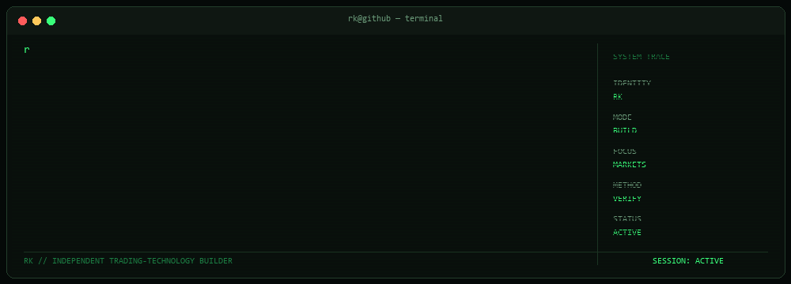

<div align="center">



<h3>INDEPENDENT TRADING-TECHNOLOGY BUILDER</h3>

<p>MARKETS &nbsp; // &nbsp; SOFTWARE &nbsp; // &nbsp; SYSTEMS ENGINEERING</p>

</div>

---

```text
rk@github:~$ cat /etc/mission

01  Understand the markets.
02  Build the technology.
03  Grow towards the enterprise.
```

I explore the intersection of financial markets, software, and systems engineering. My focus is on understanding complex systems, building practical tools, and developing the technical foundations for more sophisticated trading technology.

## `01 // CURRENT OPERATIONS`

```text
[ BUILDING ]   Trading Technology
[ BUILDING ]   Systems Engineering
[ RESEARCH  ]  Security & System Hardening
[ DEVELOPING ] Knowledge & Project Systems
```

* **Trading Technology** — Market structure, analytical workflows, and trading-system research.
* **Systems Engineering** — Python, PowerShell, automation, and configuration management.
* **Security** — System hardening and security-conscious technical practices.
* **Knowledge Systems** — Structured knowledge management and project workflows.

## `02 // TECHNOLOGY`

<p>


</p>

## `03 // SELECTED BUILDS`

Projects will appear here as they are reviewed, documented, and approved for public release.

The focus is on demonstrable work: useful tools, documented engineering decisions, reproducible workflows, and honest reporting of development and testing status.

## `04 // ENGINEERING PRINCIPLES`

```text
$ principles --list

> Understand before building.
> Test before trusting.
> Document what matters.
> Protect what should remain private.
> Prefer evidence over claims.
```

---

<div align="center">

```text
rk@github:~$ echo $PHILOSOPHY

"Build deliberately. Test rigorously. Document the work."
```

</div>
